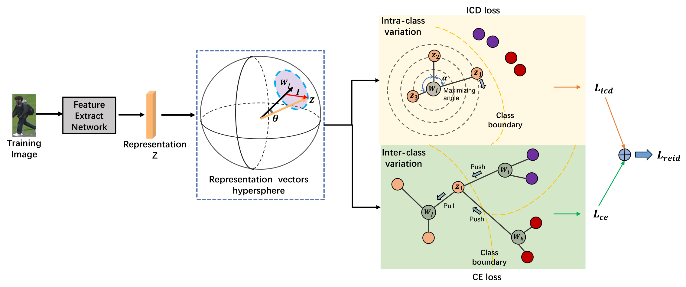

# Intra-Class Diversity Loss for Person Re-Identification

**Wei Zhou, BaXian Chen** · arXiv preprint, 2026

[](https://arxiv.org/abs/2611.30707)
[Paper (PDF)](https://arxiv.org/pdf/2611.30707) · [Standalone ICD implementation](https://github.com/321zhou-zhou/ICD-Loss-ReID-Code-Sample)

Research training code for ICD loss, adapted from [TransReID](https://github.com/damo-cv/TransReID). Wei Zhou's ICD-specific contribution is the loss formulation, PyTorch implementation, and integration into the ReID training objective.

## Method overview

ICD aims to **maximize intra-class differences in classification-irrelevant directions**. It encourages diversity in the components orthogonal to the corresponding class-weight vector, while the classification objective maintains identity discrimination. It is an auxiliary regularization term that does not require changes to the feature extraction backbone or additional ICD computation at inference time.

<p align="center">
  
</p>

*Overall ICD framework (Figure 2 of the paper).* The classification branch learns discriminative features, while the ICD branch penalizes positive cosine similarity between normalized class-orthogonal components of same-identity samples.

The training objective implemented in this repository combines CE, triplet loss and ICD:

$$
\mathcal{L}=\lambda_{\mathrm{CE}}\mathcal{L}_{\mathrm{CE}}+\lambda_{\mathrm{tri}}\mathcal{L}_{\mathrm{tri}}+\lambda_{\mathrm{ICD}}\mathcal{L}_{\mathrm{ICD}}.
$$

## Reported results

Results from Table 2 of the [arXiv paper](https://arxiv.org/abs/2611.30707), using CE + Triplet with or without ICD. Values are Rank-1 / mAP (%).

| Method | Market1501 | DukeMTMC-reID | MSMT17 |
|:--|:--:|:--:|:--:|
| ViT | 94.7 / 86.8 | 88.8 / 79.3 | 81.8 / 61.0 |
| ViT + ICD | **95.6 / 87.2** | **89.3 / 80.4** | **82.7 / 63.8** |
| TransReID | 95.2 / 89.5 | 90.7 / 82.6 | 86.2 / 69.4 |
| TransReID + ICD | **96.5 / 89.8** | **91.0 / 84.0** | **86.7 / 69.5** |

These are paper-reported results, not new runs of the released YAMLs. The release provides the global ViT training branch; AdaSP integration, JPM-based ICD, trained checkpoints and fully verified historical configurations are not included.

## Main implementation

| File | Purpose |
|:--|:--|
| [`loss/metric_learning.py`](loss/metric_learning.py) | `ICD_loss`: ArcFace-style logits and class-orthogonal diversity regularization |
| [`model/make_model.py`](model/make_model.py) | Integrates ICD into the global Transformer classifier |
| [`loss/make_loss.py`](loss/make_loss.py) | Combines identity, triplet and ICD losses |
| [`processor/processor.py`](processor/processor.py) | Training and evaluation loops |
| [`configs/`](configs/) | Dataset-specific example configurations |

## Getting started

Install dependencies in a CUDA-enabled PyTorch environment compatible with the original TransReID code (`timm==0.3.2`):

```bash
git clone https://github.com/321zhou-zhou/ICD-Loss-ReID-Training.git
cd ICD-Loss-ReID-Training
pip install -r requirements.txt
```

Prepare the dataset using its permitted distribution and access conditions. For Market1501:

```text
data/market1501/
├── bounding_box_train/
├── bounding_box_test/
└── query/
```

Download the [ImageNet-pretrained ViT-Base checkpoint](https://github.com/rwightman/pytorch-image-models/releases/download/v0.1-vitjx/jx_vit_base_p16_224-80ecf9dd.pth) into `pretrained/`. The repository does not distribute datasets or pretrained/trained weights.

### Training

The example below runs the Market1501 configuration with the paper's ICD weight of 0.1:

```bash
python train.py --config_file configs/Market/vit_base.yml MODEL.INTRA_CLASS_LOSS_WEIGHT 0.1
```

DukeMTMC-reID and MSMT17 configurations are in `configs/`. ICD uses `MODEL.JPM: False`, `MODEL.ID_LOSS_TYPE: 'ICD_loss'`, and the `softmax_triplet` sampler.

**Configuration note:** Market1501 YAML defaults are one epoch, batch size 100 and ICD weight 1.0. The paper uses batch size 120 and ICD weight 0.1. Review all settings before full training. ICD weight 0 disables the auxiliary loss while retaining the same classifier path; this alone does not establish the paper's baseline protocol.

### Evaluation

Use a checkpoint generated by your training run:

```bash
python test.py --config_file configs/Market/vit_base.yml TEST.WEIGHT ./logs/market_vit_base/transformer_1.pth
```

Replace the path with your actual checkpoint.

## Citation and acknowledgement

```bibtex
@misc{zhou2026icd,
  title         = {Intra-Class Diversity Loss for Person Re-Identification},
  author        = {Zhou, Wei and Chen, BaXian},
  year          = {2026},
  eprint        = {2611.30707},
  archivePrefix = {arXiv},
  primaryClass  = {cs.CV},
  url           = {https://arxiv.org/abs/2611.30707}
}
```

The training framework is adapted from [TransReID: Transformer-Based Object Re-Identification (ICCV 2021)](https://github.com/damo-cv/TransReID). Please also cite TransReID when using the upstream framework. The upstream MIT license and attribution are retained in [`LICENSE`](LICENSE).
